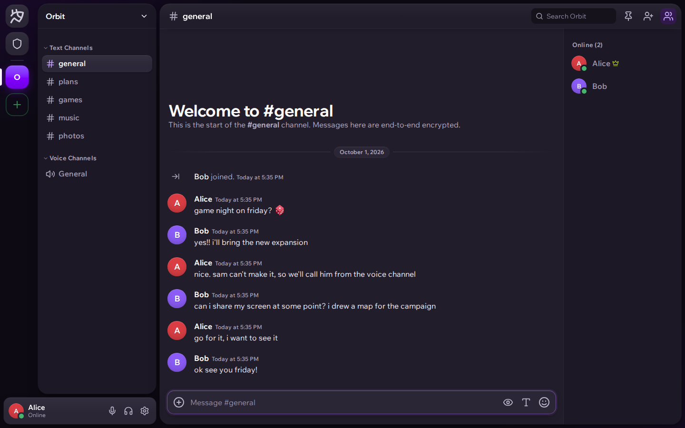

# Nexa

Nexa is a self-hosted chat app for communities and private conversations. It has a web
app, desktop apps for Windows, macOS and Linux, and a native Android app.

Try [Nexa in your browser](https://nexa.fish) or [download an app](https://nexa.fish/download).



## Features

- Direct messages, group chats, friends and custom status.
- Servers with text channels, voice channels, forums, threads, roles and permissions.
- Voice and video calls, screen sharing and guest call links.
- Formatted messages, replies, reactions, polls, search and file sharing.
- Shared notes with live editing and version history.
- Custom emoji, sticker packs, profiles and themes.
- Bots, webhooks and a plugin API.
- Data export and moderation tools.
- An interactive homepage demo that resets when you reload.

## Privacy

Personal messages, attachments, shared notes and calls use end-to-end encryption.
The server stores encrypted content along with the metadata needed to deliver it.

Webhook and app content, bug reports and moderation conversations are not end-to-end
encrypted. Account details, public profiles and server membership are also visible to
the server. Peer-to-peer calls reveal participants' IP addresses to each other; calls
through the optional Cloudflare Realtime service avoid this.

See the [privacy policy](docs/legal/PRIVACY_POLICY.txt) for details and the
[design specification](docs/superpowers/specs/2026-09-11-chat-design.md#6-end-to-end-encryption)
for the encryption design.

## Run Locally

You need Git, the Go version listed in [go.mod](go.mod), Node.js 22 or later with
npm, and Python 3 for the check scripts.

Clone the repository:

```sh
git clone https://github.com/terrydavisthe2nd/nexa.git
cd nexa
```

Build the web app and server into an isolated directory:

```sh
nexa_run_dir="$(mktemp -d)"
(cd web && npm ci && npx vite build --outDir "$nexa_run_dir/dist" --emptyOutDir)
go build -o "$nexa_run_dir/chatd" ./cmd/chatd
```

Start the server from that directory:

```sh
cd "$nexa_run_dir"
LISTEN=127.0.0.1:8080 PUBLIC_URL=http://localhost:8080 \
  WEB_DIST=./dist EGRESS_PROXY=off ./chatd
```

Open [localhost:8080](http://localhost:8080) and create an account. The first account
becomes the instance owner. The local database and uploads stay in the temporary
folder, separate from any existing installation.

This setup uses SQLite and needs no external service keys. `EGRESS_PROXY=off` sends
link-preview and media-proxy requests directly from your machine.

## Self-Hosting

The Go server serves the API, WebSocket connection, media and built web app in one
process. SQLite is the default database; PostgreSQL is supported through `DATABASE_URL`.

For a public instance:

- Set `PUBLIC_URL` to your own address and serve the app over HTTPS.
- Configure registration and any optional services you want to enable.
- Configure an outbound proxy for link previews and remote media.
- Back up the database, uploaded files and `data/server.secret` together.

All settings are documented in [chatd.env.example](chatd.env.example). Environment
variables override values in `chatd.env`. Service templates and hosting scripts are
in [deploy](deploy/); review their domain and infrastructure assumptions before use.

## Development

Install dependencies with `npm ci` in `web/` and `desktop/`. From the repository root,
run the checks without publishing a build:

```sh
tools/check.sh
```

For focused checks:

```sh
go test ./...
(cd web && npm run typecheck && npx vitest run)
(cd desktop && npm run typecheck && npm test)
python3 tools/i18n_check.py
```

Build and release commands such as `make build` and `make web` write to directories
served by a running installation. Use the isolated build above when testing changes.

The [tools guide](tools/README.md) covers browser tests and screenshots.
[CLAUDE.md](CLAUDE.md) documents the codebase, platform builds and release workflow.

## Project Layout

| Directory | Contents |
| --- | --- |
| `cmd/` | Server and database migration commands |
| `internal/` | Go server packages |
| `web/` | React and TypeScript web app |
| `desktop/` | Electron desktop app |
| `android/` | Native Kotlin and Jetpack Compose app |
| `docs/` | Design, privacy and integration documentation |
| `tools/` | Testing, asset and release tools |
| `deploy/` | Service templates and hosting scripts |

## Documentation

- [Building bots and apps](docs/bots.md)
- [Plugin API](docs/plugins.md)
- [Configuration reference](chatd.env.example)
- [Terms of service](docs/legal/TERMS_OF_SERVICE.txt)
- [Privacy policy](docs/legal/PRIVACY_POLICY.txt)

## Contributing

Nexa is open to any type of contribution to the code. Bug fixes, new features,
tests, translations, documentation and accessibility improvements are welcome.
Open an issue or pull request, and read [CLAUDE.md](CLAUDE.md) for development
guidance. Keep personal data, credentials and signing keys out of contributions;
see [repository maintenance](docs/REPOSITORY.md).

## License

[MIT](LICENSE). Copyright (c) 2026 terrydavisthe2nd / Nexa.
Third-party components retain their own licenses and notices.
